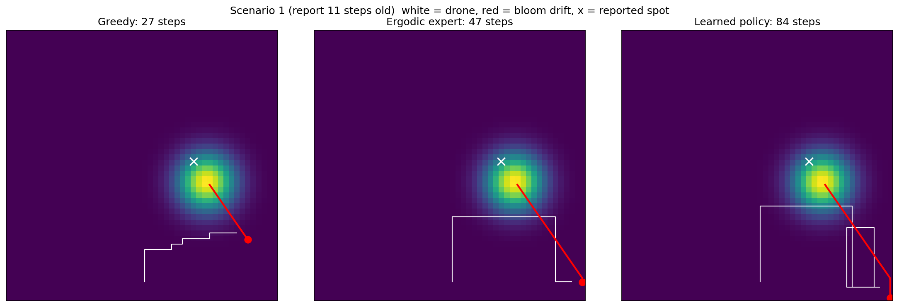
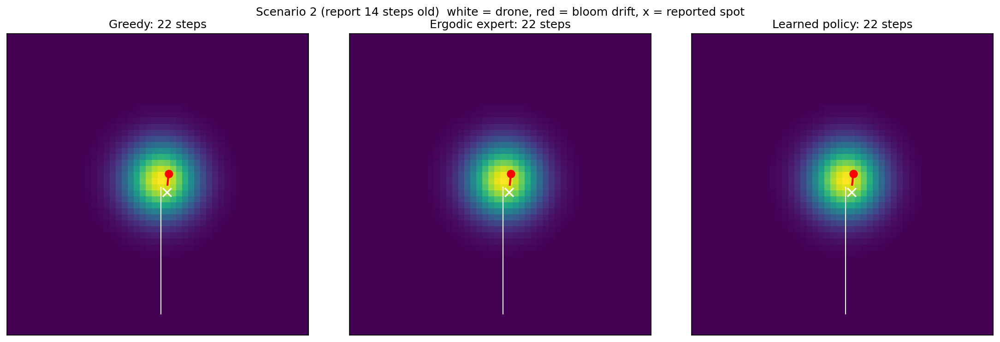
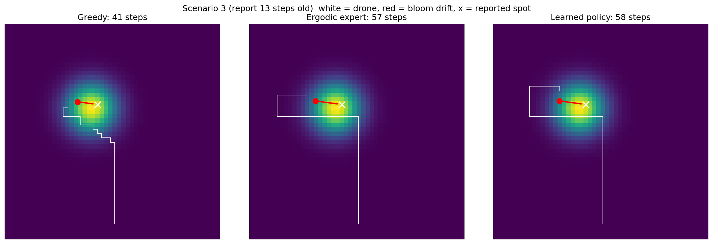

# Algae Bloom Search: Imitation Learning from an Ergodic Expert

A Python simulator where a drone relocates a drifting algae bloom from an outdated report, plus a PyTorch policy trained to imitate an ergodic search planner.

## Scenario

Someone reports an algae bloom at a location. By the time the drone arrives, the bloom has drifted with the water current, and the current is only known approximately.

- **Prior:** a probability map centered where the bloom should be after drifting with the *estimated* current. Older reports produce wider, more uncertain maps.
- **True bloom:** drifts with the *actual* current, which differs slightly from the estimate.
- **Bayes filter:** every step, the drone crosses off the area it searched (update) and shifts and spreads the map with the estimated current (predict).
- 50x50 grid, drone sees a 5x5 area and moves one cell per step.

## Strategies

- **Lawnmower:** sweeps the whole area row by row. Ignores the report.
- **Greedy:** always moves toward the single most likely cell.
- **Ergodic expert:** greedy planner minimizing the Fourier ergodic metric, with exponential forgetting of old coverage since the target moves.
- **Learned policy:** a neural network trained by behavior cloning to imitate the ergodic expert.

## Imitation learning

**Observation (344 values):** an 11x11 local window of the probability map, an 11x11 decaying trail of recent drone positions, a coarse 10x10 overview of the full map, and the drone's position.

**Dataset:** 500 expert runs on training scenarios. Only successful runs were kept (428), giving 26,311 state-action pairs. About 47% of actions are "up," so always predicting "up" gives 47% accuracy.

**Model:** MLP (344 → 256 → 256 → 4), cross-entropy loss, Adam, 20 epochs.

**Accuracy:** 94% on held-out validation steps, vs. 47% for the majority-class baseline.

## Results

200 test scenarios never seen during training:

| Strategy | Avg steps | Median steps | Failed | Compute time |
|---|---|---|---|---|
| Lawnmower | 396.5 | 514.0 | 28 | 0.4s |
| Greedy | 139.7 | 54.0 | 20 | 3.1s |
| Ergodic expert | 145.4 | 60.5 | 18 | 30.6s |
| Learned policy | **134.5** | 58.0 | **14** | 15.7s |





More examples in [`paths/`](paths/).

## Observations

- **The learned policy matched or slightly beat the expert** with fewer failures, at about half the compute. A likely reason: it was trained only on the expert's successful runs, so it never learned the behaviors that led to failures.
- **Compounding error did not collapse performance** here, even though behavior cloning is known to suffer when small mistakes lead to unfamiliar states.
- **Greedy and ergodic performed about the same.** With a single bloom, flying toward the peak is hard to beat. Ergodic search is more useful when the target could be in several places.
- **Lawnmower was worst** because the bloom drifts out of areas it already swept.

## Limitations

- Differences between greedy, expert, and learned policy are small and come from one set of 200 test scenarios. More trials and error bars would be needed to claim one is better.
- Validation accuracy is somewhat optimistic: steps were split randomly, so similar steps from the same run can appear in both training and validation sets.
- Training loss kept decreasing after validation accuracy plateaued around epoch 8 (mild overfitting).
- About 10% of runs fail for every strategy, likely when the bloom drifts to the map edge and the predicted map shifts off the grid.
- Simplified physics: constant current, one-cell moves, perfect sensor, single bloom.

## Next steps

- **DAgger:** collect expert labels on states the learned policy visits, to directly address compounding error.
- **Diffusion policy:** replace behavior cloning with a small diffusion model.

## Files

- `world.py`: scenarios, drift, and the predict step
- `expert.py`: ergodic expert with Bayesian updates and forgetting
- `compare.py`: lawnmower and greedy baselines
- `dataset.py`: observation design and demonstration collection
- `train.py`: behavior cloning in PyTorch
- `evaluate.py`: closed-loop comparison of all strategies
- `plot_paths.py`: side-by-side path images
- `policy.pt`: trained model weights

## Run

```
pip install numpy matplotlib scipy torch
python dataset.py
python train.py
python evaluate.py
python plot_paths.py
```